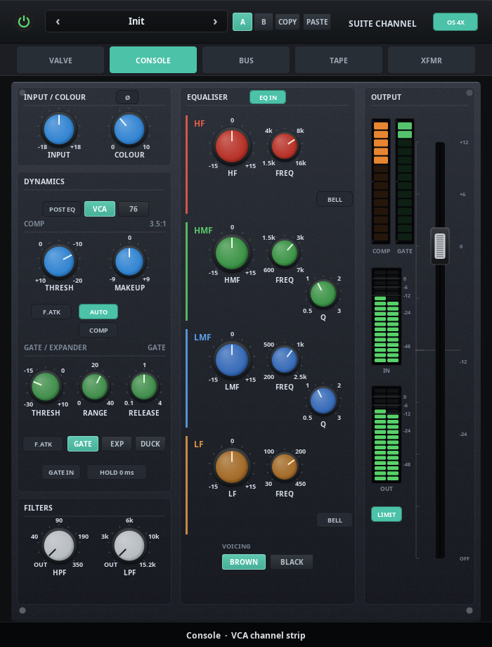
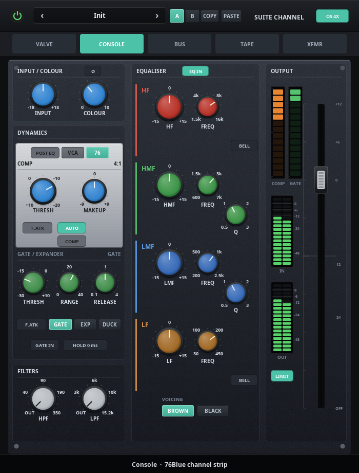
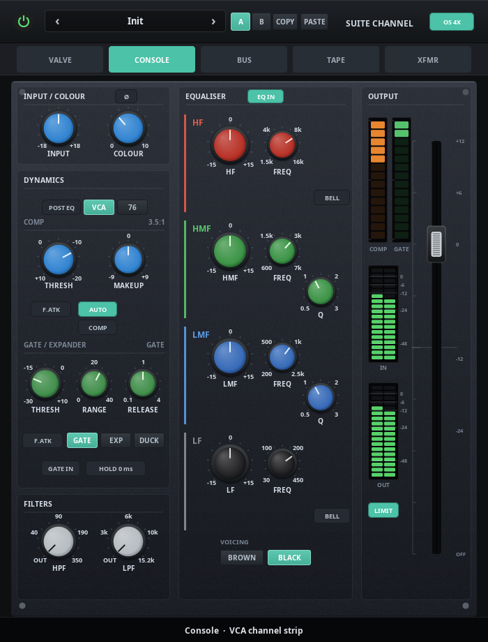

# Suite Channel Plus

**Version 0.3.0** · Suite Control edition · GPL-3.0-or-later · CLAP + LV2 · Linux

Suite Channel Plus is Suite Channel plus a **Control Bus** selector that lets
Suite Control drive it remotely. Everything else - sound, presets, latency and
layout - is identical to Suite Channel; the two plug-ins can sit in the same
project. If you do not use the control surface, plain Suite Channel is
unchanged and needs no peer registration.

It combines:

- five Patina colour voicings,
- an SSL-style expander/gate,
- a switchable **VCA / 76Blue** compressor with fixed ratios,
- the vendored Dusk **4K EQ 2** four-band console EQ with Brown/Black voicings
  and HPF/LPF,
- a vertical output fader and metering;
- a factory and user preset bank with save, rename, duplicate, delete, export
  and drag-drop import.

The 700×920 strip opens at 1.0× on a 1080p display, and scales down on smaller
screens. It is an independent design. It is not affiliated with or endorsed by
Solid State Logic, Waves, Universal Audio, Dusk Audio, or any hardware
manufacturer.





*76Blue swaps the compressor panel to brushed silver and keeps the same
control surface.*



*Black EQ voicing changes the LF knob fill from tan to black and switches the
DSP to the Black law.*

## Signal flow

```
Input trim → Colour → Gate → Compressor → HPF/LPF → 4-band EQ → Output
```

`DYN POST` moves the gate and compressor after the EQ/filter block.

The Dusk EQ core keeps its own oversampling. The colour stage uses ADAA and the
dynamics are linear gain, so the only reported latency is the EQ oversampler.

## Controls

### Input / Colour

- **Input**: ±18 dB.
- **Colour**: one Amount knob for the selected Patina model. At 0 the stage is
  exact dry; the auto-gain keeps the amount level-neutral.
- Colour tabs: **Valve**, **Console**, **Bus**, **Tape**, **Transformer**.

### Filters

- **HPF**: out, 16–350 Hz.
- **LPF**: out, 15.2 k–3 k.

These are the 4K EQ 2 calibrated filters.

### EQ

- **Brown / Black**: full voicing switch, including different Q and interaction
  laws.
- **LF**: ±15 dB, 30–450 Hz, shelf or bell.
- **LMF**: ±15 dB, 200–2500 Hz, Q 0.5–3.0.
- **HMF**: ±15 dB, 600–7000 Hz, Q 0.5–3.0.
- **HF**: ±15 dB, 1.5–16 kHz, shelf or bell.
- **EQ IN**: constant-latency wet/dry crossfade; the reported latency does not
  change when it is toggled.

### Dynamics

**Compressor**

- **Type**: VCA or 76Blue.
- **VCA**: fixed **3.5:1**, threshold +10…−20 dB, 30 ms attack / 3 ms F.ATK,
  300 ms release, ±9 dB makeup.
- **76Blue**: fixed **4:1**, same control surface, real threshold through the
  FET gain cell, ~0.9 ms / 40 µs F.ATK, ~370 ms release.
- **AUTO**: slow average gain-reduction makeup.
- **F.ATK**: selects the fast attack.
- **COMP**: compressor in/out.

**Expander / Gate**

- **THRESH**: −30…+10 dB.
- **RANGE**: 0–40 dB attenuation floor.
- **RELEASE**: 0.1–4 s.
- **HOLD**: 0 / 50 / 100 / 200 / 400 / 500 ms; keeps the gate open after the
  signal falls below the threshold.
- **F.ATK**: 1.5 ms / 40 dB or 100 µs / 40 dB.
- **GATE / EXP / DUCK**: high-ratio gate, fixed 1:2 downward expansion, or
  ducker (attenuates above the threshold).
- A fast peak envelope feeds the detector, so the gate does not chatter on
  zero crossings.
- Variable hysteresis prevents chatter; the gate is before the compressor.
- A patched sidechain keys the detector in gate and ducker modes. A silent
  buffer on an unpatched sidechain port is ignored until the port actually
  carries signal, so the gate cannot lock closed by accident.
- **GATE**: gate in/out.

### Output / metering

- **Output fader**: Off to +12 dB, with 0 dB about 3/4 of the way up.
- **COMP** GR meter (orange), **GATE** GR meter (green).
- Stereo output peak meter.
- **LIMIT**: switches the −0.2 dBFS safety ceiling on or off. It is on by
  default.
- **OS**: Off / 2x / 4x. Default 4x, matching 4K EQ 2. At 88.2/96 kHz 4x is
  capped at 2x; at 176.4/192 kHz it is capped at 1x.
- **PWR**: click-free master bypass.

### Editing gestures

- **Drag** a knob or fader to change it; the exact value appears in a bubble.
- **Right-click** a knob, fader or **HOLD** pill to type a value. Units such as
  `-6 dB`, `1.2 kHz`, `250 ms` and `on`/`off` are accepted. **Enter** applies,
  **Esc** cancels, **Backspace** edits.
- **Double-click** a knob or fader to restore its default.
- **A / B**: two editor-local compare slots. Switching stores the current
  settings in the slot you leave and recalls the slot you enter.
- **COPY**: captures the live settings. **PASTE** applies them, so you can
  copy from one slot and paste into the other.

A/B slots and the copy/paste clipboard live in the editor and are not saved in
host state.

## Presets

Factory banks: Vocal, Drums, Bass, Guitars, Mix Bus, Utility. Every preset
stores the compressor type and colour model explicitly. Oversampling and power
stay global.

## Build

Requirements: Linux, C++17, CMake ≥ 3.16, `lv2`, `cairo`, `freetype2`, `x11`.

```sh
cmake -S . -B build -DCMAKE_BUILD_TYPE=Release
cmake --build build -j"$(nproc)"
ctest --test-dir build --output-on-failure
```

The CLAP headers, hearth-dsp and the Dusk 4K EQ 2 core are vendored under
`third_party/`.

## Install

```sh
cmake -S . -B build \
  -DCMAKE_BUILD_TYPE=Release \
  -DCLAP_DIR="$HOME/.clap" \
  -DLV2_DIR="$HOME/.lv2"
cmake --build build -j"$(nproc)"
cmake --install build
```

The LV2 bundle is `~/.lv2/suite-channel.lv2`; the CLAP is
`~/.clap/SuiteChannel.clap`.

## URI stability

The LV2 URI is
`https://github.com/tylorismusic-commits/suite-channel`. It embeds the GitHub
path, so renaming the repository or moving the project would break every saved
session. Treat the URI as permanent.

## Current status

0.2.5 sharpens the editor at reduced scales with full font hinting, integer
metrics, physical-pixel text snapping and a nearest-neighbour present.
0.2.4 tightened the Input/Colour and EQ knob groups against their labels,
centres the filter knobs, moves the phase and EQ IN buttons above their section
rules, and clears the EQ Freq/Q scale labels from the knob bodies.
0.2.3 put the gate GR meter on the CLAP/LV2 meters, aligned the phase and EQ IN
buttons with their section headers, centred the wordmark, and aligned every
knob-name baseline within its row. 0.2.2 fixed the gate locking closed when a
host supplied a silent sidechain buffer, flashes COPY/PASTE green on success,
compacts those buttons and sizes the oversampling control to its text. 0.2.1 added **PASTE** and fixed the
typed-value field, centres the gate button rows and makes every parameter
report the same option names in the editor and the host.
0.2.0 added gate **Hold** and **Ducker** modes, an output **LIMIT** switch,
typed value entry, double-click reset, drag value bubbles and A/B compare.
0.1.6 put output unity at 3/4 travel, with +12 dB at the top and off at the
bottom. 0.1.5 gave the output fader a true off position. 0.1.2 corrected the
input meter to measure after the input trim; 0.1.1 added the stacked stereo
input level meter. CLAP and LV2 load, the editor renders, the DSP runs, the
factory presets are generated, and the tests cover VCA/76, Brown/Black,
presets, gate/expander/ducker/hold, the limiter, typed values, A/B, power
bypass and all oversampling modes. The remaining gates are the explicit EQ
parity measurement against the upstream Dusk core and the full
Ardour/Carla/REAPER matrix.

## Licence

GPL-3.0-or-later. See `LICENSE` and `THIRD_PARTY_NOTICES.md`.

The vendored Dusk 4K EQ 2 core is GPL-3.0 and is used with attribution. Tukan’s
SumChannel was used only as a behavioural reference; no Tukan code is included.


## Suite Control

The **BUS** selector in the header assigns this instance to a Suite Control
bucket (Off / A-H). Suite Control on the folder track lists every instance on
its selected bucket and mirrors Input, Comp threshold/makeup, Comp In, EQ In and
Output both ways.

Remote moves arrive as host parameter events, so the host automation lane and
this editor follow the surface. `CAPTURE` on Suite Control assigns every
unassigned instance to the current bucket.

The peer link uses a per-host-process shared-memory registry; it needs no
configuration. If the host runs plug-ins in separate processes the surface
cannot see them.
